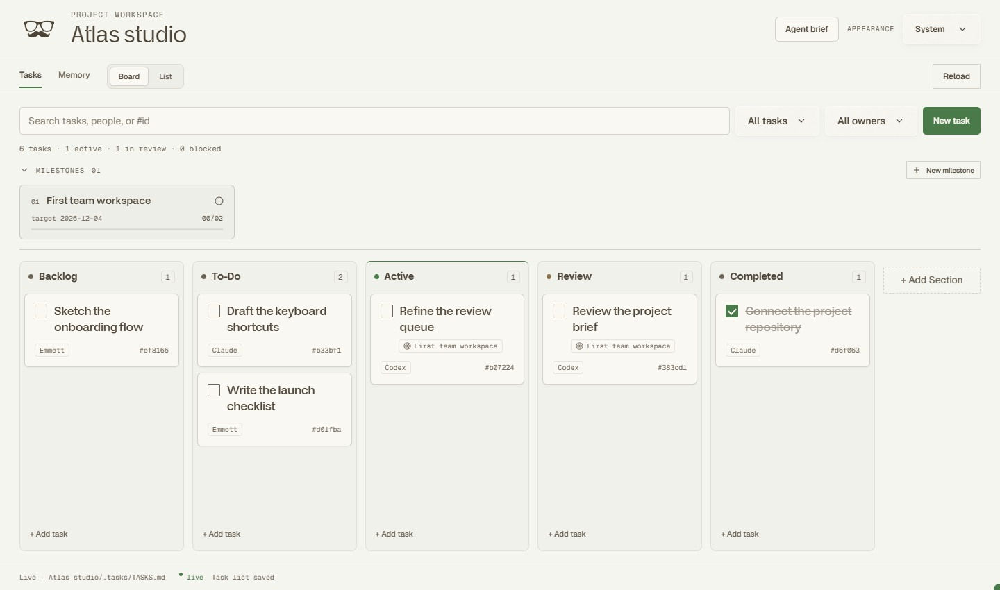

# SHAUGHV Tasks

A Markdown project board for people building software with coding agents. Plan the work, assign an owner, discuss a result, and review the evidence together. People use the local dashboard. Agents can make the same changes from the terminal. Both work in the project's `.tasks/` folder.

**Give a new agent this link:** [Agent quickstart](https://github.com/RealEmmettS/shaughv-tasks/blob/main/AGENT-QUICKSTART.md). Tell it, “Set up or resume the task board in this project.” The guide covers installation, launch, collaboration, and recovery.



## Install with npx

From your project, run:

```sh
npx skills add RealEmmettS/shaughv-tasks
```

Choose all seven skills and the agents you use. To install them directly for Codex and Claude Code in this project:

```sh
npx skills add RealEmmettS/shaughv-tasks --skill "*" --agent codex claude-code -y
```

To install all seven for every supported agent in this project, use `--agent "*"`. Add `-g` for a user-wide installation. The npx installer requires Node.js 22.20 or later. [Installer reference](https://github.com/vercel-labs/skills)

Ask your agent to **start the task board**. For a manual launch, run the setup helper in the installed `tasks-start/assets` directory with your project as the working directory. For the standard Codex project install:

```sh
node .agents/skills/tasks-start/assets/setup.mjs
```

Open the localhost URL it prints. Running setup again resumes or upgrades the same board. New boards in Git are shareable by default. Use `--local` on first setup for a Git-ignored board. Nothing is committed automatically.

## Downloads and other installs

| Format | How to use it |
| --- | --- |
| [Complete ZIP](https://github.com/RealEmmettS/shaughv-tasks/releases/latest/download/shaughv-tasks.zip) | Extract it. Copy the seven folders from `skills/` to your agent's skills directory, or run `node "/path/to/extracted/skills/tasks-start/assets/setup.mjs" --project "/path/to/project"` directly. |
| [Individual .skill downloads](https://github.com/RealEmmettS/shaughv-tasks/releases/latest) | Download [tasks-start.skill](https://github.com/RealEmmettS/shaughv-tasks/releases/latest/download/tasks-start.skill) or choose any of the seven release assets. Import the desired files into a host that supports skill uploads. Use the complete ZIP for the whole system and its cross-skill references. A chat-only host can work from files or a handoff. |
| Codex marketplace | Run `codex plugin marketplace add RealEmmettS/shaughv-tasks`, then `codex plugin add shaughv-tasks@shaughv-tasks`. |
| Claude Code marketplace | Run `/plugin marketplace add RealEmmettS/shaughv-tasks`, then `/plugin install shaughv-tasks@shaughv-tasks`. Use `/shaughv-tasks:tasks-start`. |

## Working together

- **Plan and assign.** Create a task, choose a human or agent as owner, and add prerequisites, subtasks, and success criteria. Use milestones for larger outcomes.
- **Build and review.** Move work from Backlog through To-Do and Active into Review. Either operator can comment, post results, check criteria, and complete or reopen tasks. Existing custom columns are preserved.
- **Hand off.** **Agent brief** prepares the whole project for a new chat. **Copy handoff** in a task includes its saved Markdown record. A chat with file access can work directly. A chat with only a snapshot can propose changes for reconciliation.
- **Keep the record.** `.tasks/TASKS.md` and `MILESTONES.md` hold the indexes. `.tasks/tasks/<id>.md` holds a task's comments, results, criteria, and activity. `.tasks/CLAUDE.md` and `memory/` hold shared context. Git transports tracked records between checkouts. Open tabs on the same local server update live.

## Updates

For npx installs, run `npx skills update` in the project or `npx skills update -g` for a user-wide install. For Codex, run `codex plugin marketplace upgrade shaughv-tasks` followed by `codex plugin add shaughv-tasks@shaughv-tasks`. For Claude Code, update the marketplace and installed plugin. For manual installs, replace the downloaded skill folders. Run **tasks-start** again in each project to apply the upgrade and retain its records.

[Agent operations](skills/tasks-start/references/agents.md) · [Release notes](HUMAN_CHANGELOG.md) · [ChatGPT handoffs](skills/tasks-management/references/chatgpt.md)
